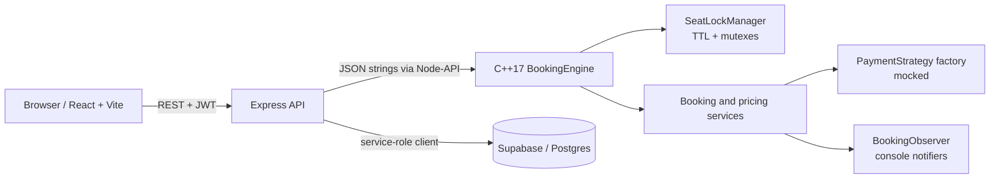

# BookMyShow

BookMyShow is a movie ticket booking app with a React/Vite client, an Express API, a C++17 booking engine exposed through Node-API, and Supabase/Postgres persistence. Users browse shows, hold seats for a limited time, pay through a mocked payment strategy, and manage confirmed bookings.

## Architecture



## Setup

### Prerequisites

- Node.js 20+ and npm
- CMake 3.16+, a C++17 compiler, Python 3, and the native build prerequisites for your OS
- A Supabase project with SQL Editor access

### Supabase

1. Run [`db/schema.sql`](db/schema.sql) in the Supabase SQL Editor.
2. Run [`db/seed.sql`](db/seed.sql) to add sample cities, theatres, seats, movies, and shows.
3. Open `backend/.env` (copy it from `backend/.env.example` if missing). Set `SUPABASE_URL` and `SUPABASE_SERVICE_ROLE_KEY` from Supabase **Project Settings → API**, and a strong `JWT_SECRET`. Optional: `PORT`, `LOCK_TTL_SECONDS`, `THEATRE_UTC_OFFSET_MINUTES` (default 330 = IST).

`db/schema.sql` enables Row Level Security on every table with no policies, so the public anon key cannot read or write data; only the backend's service-role key can.

The service-role key belongs only in the backend environment. Do not put it in frontend variables or commit it.

### Core engine

```sh
cd backend
npm install
npm run build:core
npm run smoke:core
```

The CMake project and addon sources are in `core/`; the backend build command places the Node addon in `core/build-node/Release/`.

### Backend

```sh
cd backend
npm start
```

The API listens on port 4000 by default. For API paths and request bodies, see [`docs/api.md`](docs/api.md). The Supertest suite runs with `npm test`.

### Frontend

In another terminal:

```sh
cd frontend
npm install
npm run dev
```

Open http://localhost:5173. The frontend calls `/api` on its own origin and the Vite dev server proxies it to the backend at `http://localhost:4000` (change `BACKEND_URL` in `frontend/.env` if the API runs elsewhere). No Supabase key is needed in the frontend.

### Optional Docker Compose

After preparing `backend/.env` and applying the Supabase SQL files, from the repository root run:

```sh
docker compose up --build
```

The frontend is served on port 5173 (nginx proxies `/api` to the backend container) and the API on port 4000. The backend image is built from the repository root because it compiles `core/`. Compose does not run a local database; the backend connects to the configured Supabase project.

## Design patterns

| Pattern | Implementation |
|---|---|
| Singleton | `core/src/services/SeatLockManager.cpp` provides the process-wide registry of live shows and the expiry thread. |
| Strategy | Pricing rules (`SeatTypePricing`, `WeekendPricing`, `PeakHourPricing`), payment modes (card, UPI, net banking) and refund policies (`TieredRefundPolicy`, `FullRefundPolicy`). |
| Rule chain | `core/src/pricing/PricingEngine.cpp` applies pricing strategies in order; a new rule is a new class (Open/Closed). |
| Factory | `core/src/payment/PaymentFactory.cpp` constructs a payment strategy for a `PaymentMode`. |
| State machine | `ShowSeat` (AVAILABLE/LOCKED/BOOKED) and `Booking` (PENDING/CONFIRMED/CANCELLED/EXPIRED) allow only legal transitions. |
| Aggregate root | `core/src/models/Show.cpp` owns its seats and their lock, so multi-seat changes are atomic. |
| Observer | `core/src/services/NotificationService.cpp` publishes booking events to `EmailNotifier` and `SmsNotifier` observers (currently console logs). |
| Facade | `core/include/BookingEngine.hpp` exposes the engine's JSON-in/JSON-out API to the Node binding. |
| Dependency injection | `BookingService` receives its pricing engine and refund policy through the constructor. |

The full explanation, with diagrams, code walkthroughs and interview questions, is in [`docs/BookMyShow-LLD-Guide.pdf`](docs/BookMyShow-LLD-Guide.pdf) (summary in [`docs/LLD.md`](docs/LLD.md)).

## Concurrency approach

Seat locks are held in the C++ process. The show registry uses a reader/writer lock, and each `Show` guards its seats with one mutex: a multi-seat request checks every seat before changing any, so it is all-or-nothing with nothing to roll back, and because a request holds at most one show lock it cannot deadlock. Requests for different shows run in parallel. The engine uses `std::chrono::steady_clock` for lock expiry and periodically releases expired holds. The database's `UNIQUE (show_id, seat_id)` constraint protects confirmed bookings as a final persistence guard. Run the HTTP race demo with two existing accounts:

```sh
cd backend
DEMO_USER_ONE_EMAIL=one@example.com DEMO_USER_ONE_PASSWORD='...' \
DEMO_USER_TWO_EMAIL=two@example.com DEMO_USER_TWO_PASSWORD='...' \
npm run demo:concurrency
```

The script discovers a currently available seat, sends both lock requests concurrently, prints both responses, and releases the winner's lock.

## Known limitations

- **Single instance:** the in-memory engine and locks coordinate requests only within one Node process.
- **In-memory locks and pending bookings:** process restart loses active holds and pending engine bookings; confirmed bookings remain in Supabase.
- **Mocked payments:** payment strategies simulate success and do not contact a payment provider or move real money.

## Status

- [x] Stage 1: Set up the C++17 core project and build configuration
- [x] Stage 2: Define domain enums and models
- [x] Stage 3: Implement seat state and thread-safe locking
- [x] Stage 4: Add pricing strategies
- [x] Stage 5: Add payment strategies and factory
- [x] Stage 6: Add booking notifications and observers
- [x] Stage 7: Implement the engine JSON interface and Node-API binding
- [x] Stage 8: Create the Supabase schema and seed data
- [x] Stage 9: Set up the Node.js backend and Supabase access
- [x] Stage 10: Implement REST routes, validation, and authentication
- [x] Stage 11: Build the React frontend and API integration
- [x] Stage 12: Connect seat selection, locking, checkout, and payment
- [ ] Stage 13: Add booking history and complete real-database end-to-end verification
