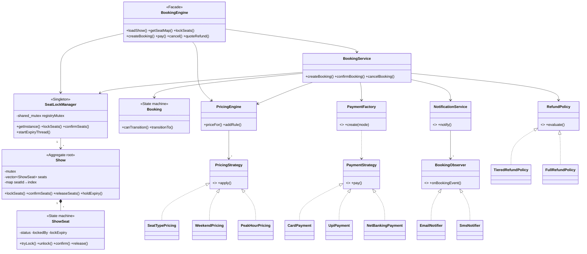
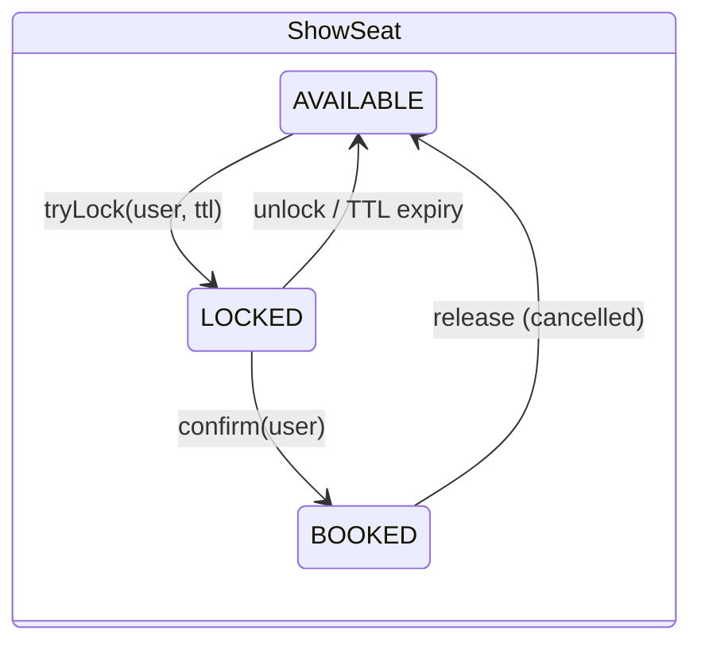
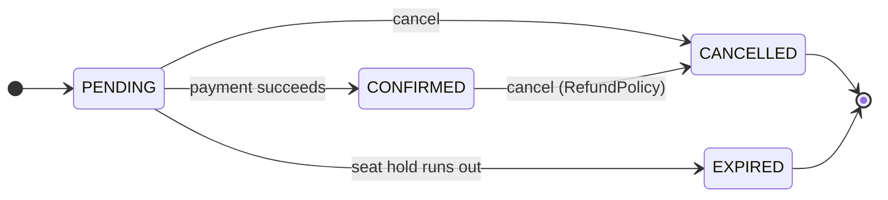
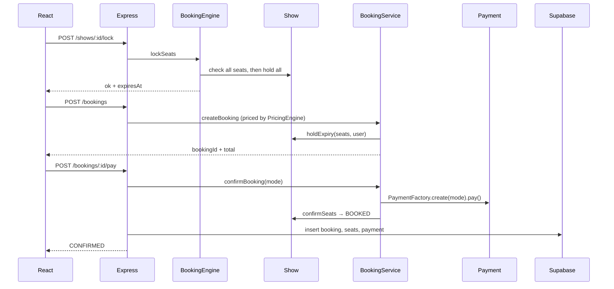

# BookMyShow – Low-Level Design

Short summary of the booking engine in `core/`. The full guide, with code walkthroughs and interview questions, is [`BookMyShow-LLD-Guide.pdf`](BookMyShow-LLD-Guide.pdf).

## Class diagram

## State machines

## Design patterns

| Pattern | Where | Why |
|---|---|---|
| Singleton | `SeatLockManager::getInstance()` | One registry of live shows and one expiry thread per process |
| Strategy | `PricingStrategy`, `PaymentStrategy`, `RefundPolicy` | Swappable pricing rules, payment modes and refund rules |
| Rule chain | `PricingEngine` | New pricing rule = new class, no edits to existing code |
| Factory | `PaymentFactory::create(mode)` | Callers never construct concrete payment classes |
| State machine | `ShowSeat`, `Booking` | Only legal transitions are possible |
| Aggregate root | `Show` | All seat changes under one lock, so multi-seat ops are atomic |
| Observer | `NotificationService` + `EmailNotifier`, `SmsNotifier` | Booking logic does not know who listens |
| Facade | `BookingEngine` | One JSON API for Node.js |
| Dependency injection | `BookingService` constructor | Pricing and refund policy are swappable and testable |

## Concurrency in one paragraph

The show registry uses a `std::shared_mutex` (many concurrent lookups). Each `Show` has one mutex; a multi-seat request checks every seat and only then changes them all, so it is all-or-nothing with nothing to roll back. A request holds at most one show lock, so it cannot deadlock, and different shows never block each other. Holds expire on a `steady_clock` deadline: an expired hold reads as available immediately, and a background thread clears it. Postgres `UNIQUE (show_id, seat_id)` is the final guard. Tests race 50 threads for the same seats; the suite is clean under ThreadSanitizer.

## Booking flow

